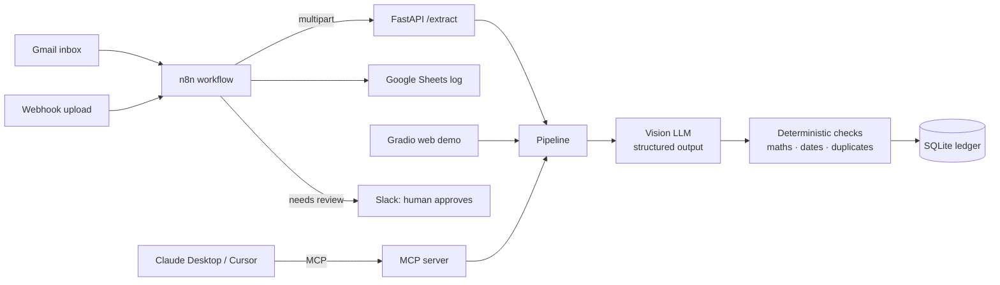

# Invoice Autopilot: an AI accounts-payable agent

**Invoices arrive by email → AI extracts every field → code verifies the maths → clean ones are logged
automatically, suspicious ones go to a human on Slack. Ask Claude about your payables in plain English.**

| Piece | What it does | Tech |
|---|---|---|
| **AI extraction** | Reads PDFs, scans and phone photos into a strict schema | Vision LLM (Claude / Gemini / OpenAI), structured output, Pydantic |
| **Verification** | Line maths, subtotal, total, dates, duplicate / double-billing detection | Plain Python, no LLM |
| **n8n workflow** | Gmail → extract → Google Sheets → Slack review | n8n (importable JSON) |
| **MCP server** | Lets Claude Desktop / Cursor process folders, approve, report | Model Context Protocol |
| **REST API** | `/extract`, `/invoices`, `/review`, `/reports` | FastAPI, API-key auth |
| **Ledger** | Single source of truth with review status | SQLite |
| **Web demo** | Upload → fields, checks, Excel/JSON | Gradio (Hugging Face Spaces) |
| **Deploy** | API + n8n in one command | Docker Compose |



## Why it's built this way

- **The model reads; code checks.** LLMs are good at reading messy documents but can still misread a
  digit. The model only copies what is printed. Python verifies every total, so a misread number is
  flagged, never silently booked.
- **Human in the loop where it matters.** Clean invoices are auto-approved; anything that fails a check
  (wrong total, bad date, same invoice number twice) waits for a person.
- **Idempotent.** The same file is never processed twice (content hash), so n8n retries and re-sent
  emails don't create duplicates.

Try `samples/sample_invoice_with_error.pdf` in the web demo: the printed total is wrong on purpose.

---

## 1. Web demo (Gradio)

```bash
pip install -r requirements.txt
export ANTHROPIC_API_KEY=...       # or GEMINI_API_KEY / OPENAI_API_KEY
python app.py
```

## 2. MCP server for Claude Desktop / Cursor

Add to `claude_desktop_config.json` (Claude Desktop → Settings → Developer → Edit config):

```json
{
  "mcpServers": {
    "invoice-autopilot": {
      "command": "python",
      "args": ["/absolute/path/to/invoice-autopilot/mcp_server.py"],
      "env": { "ANTHROPIC_API_KEY": "your-key" }
    }
  }
}
```

Then ask:

- *"Process every invoice in ~/Downloads/invoices and tell me which need review."*
- *"What do we owe in the next 14 days? Anything overdue?"*
- *"Show me why invoice 4 failed, then approve it: the vendor confirmed the total."*
- *"Who did we spend the most with, by month?"*

Tools: `process_invoice`, `process_folder`, `list_invoices`, `get_invoice`, `review_invoice`,
`spend_summary`, `upcoming_payments`. Prompt: `weekly_ap_review`.

## 3. API + n8n with Docker

```bash
cp .env.example .env               # add your ANTHROPIC_API_KEY (and optionally API_KEY)
docker compose up --build
```

- API docs: http://localhost:8000/docs
- n8n: http://localhost:5678 → **Import from file** → `n8n/invoice_autopilot.workflow.json`
- Connect your Gmail, Google Sheets and Slack credentials in n8n, paste your Sheet URL into
  *Log to Google Sheets* (sheet named `Invoices`), then activate.

Test without Gmail:

```bash
curl -F "file=@samples/sample_invoice_clean.pdf" http://localhost:5678/webhook/invoice-autopilot
```

## Tests

```bash
pip install pytest
pytest -q
```

15 tests: the checks, ingest/export, the API (auth, dedupe, double-billing, review, reports) and the
MCP tools, all run offline with the LLM call stubbed.

## Project layout

```
app.py                 Gradio web demo
api.py                 FastAPI service (used by n8n)
mcp_server.py          MCP server (Claude Desktop / Cursor)
extractor/
  ingest.py            PDF rendering + image normalisation
  llm.py               Claude / Gemini / OpenAI structured extraction
  schema.py            Pydantic output schema
  validate.py          Deterministic checks
  ledger.py            SQLite ledger, reports
  pipeline.py          One entry point for all of the above
  export.py            Excel / JSON export
n8n/                   Workflow JSON + the script that generates it
```

## Adapting it for a business

Common additions: your own fields (PO number, GL code, cost centre), three-way matching against purchase
orders, vendor-specific rules, approvals in Slack with buttons, and pushing approved bills into
QuickBooks, Xero, Zoho Books or an ERP.

---
Built by **Yash Shah**, AI Engineer. Sample invoices are for fictional companies.
